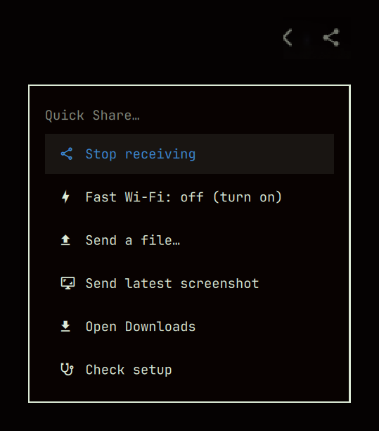

# Quick Share for Omarchy

Send files between your Omarchy PC and an Android or Samsung Galaxy phone with the phone's own **Share → Quick Share**. You don't install anything on the phone, and the phone and PC don't need to be on the same Wi-Fi.



- **Receive**: share from the phone, pick this PC, then choose **Accept** in the menu that pops up. The file lands in `~/Downloads`.
- **Send**: click the bar icon and pick a file, or send your latest screenshot.
- **One icon** on the bar. It shows when receiving is on and when a file is coming in or going out.

The Quick Share protocol comes from [quickshare-direct](https://github.com/papshmeare/quickshare-direct), over Bluetooth plus Wi-Fi Direct. This plugin adds the bar icon, the `quickshare` command, and Accept/Decline prompts that work with Omarchy's notifications.

## Install

```bash
curl -fsSL https://raw.githubusercontent.com/Emanuel4100/omarchy-quickshare/main/install.sh | bash
```

You can run it again at any time. Steps that are already done are skipped, and it ends with a checklist of the whole setup.

<details>
<summary>Or the Omarchy way, step by step</summary>

```bash
omarchy plugin add https://github.com/Emanuel4100/omarchy-quickshare.git --enable
~/.config/omarchy/plugins/emanuel.quickshare/install.sh
```

If you only run the first command, the bar icon says *"isn't set up yet"*. Clicking it runs the installer in a terminal.

</details>

<details>
<summary>What the installer changes</summary>

| Step | What it does | sudo |
|---|---|---|
| quickshare-direct | Downloads the latest release package, checks it against the release's `SHA256SUMS`, and installs it with `pacman -U` | yes |
| Firewall | `ufw allow quickshare-direct` (TCP 46257–46258), if ufw is on | yes |
| Wi-Fi region | Only if none is set: asks for your country (suggested from your timezone), then runs `iw reg set` and saves it in `/etc/conf.d/wireless-regdom` | yes |
| Notifications | Installs the Quick Share icon in `~/.local/share/icons`, and writes one `PATH=` line to `~/.config/quickshare-direct/env` so Accept/Decline opens as an Omarchy menu ([why](#how-it-works)) | |
| Command | Links `quickshare` into `~/.local/bin` | |
| Receiving | `systemctl --user enable --now quickshare-direct` | |
| Bar | `omarchy plugin enable emanuel.quickshare` | |
| Fast Wi-Fi | Asks once, default **no** ([details](#faster-transfers)) | yes |

</details>

**Needs:** Omarchy and Bluetooth. A Wi-Fi card with Wi-Fi Direct is optional; it's only for [faster transfers](#faster-transfers).

## Use it

**Receive:** on the phone, open **Share → Quick Share**, pick this PC (its host name), then choose **Accept** on the PC. With Omarchy's own notifications, a received photo shows up as a thumbnail.

**Send:** first put the phone on its Quick Share receive screen, or set its visibility to *Everyone*. Then click the bar icon.

| Bar icon | Action |
|---|---|
| Left click | Pick a recent file and send it |
| Middle click | Open Downloads |
| Right click | Menu: receiving on/off, fast Wi-Fi on/off, send a file, send the latest screenshot, open Downloads, check setup |

The icon is an outline while receiving is off. It turns into a down arrow while a file comes in and an up arrow while one goes out.

```bash
quickshare send ~/file.pdf        # no file: opens a picker
quickshare receive on|off|toggle
quickshare fast on|off
quickshare menu                   # the right-click menu
quickshare doctor                 # check the setup
quickshare status                 # {"installed":…,"receiving":…,"fast":…}
```

## Faster transfers

Without fast mode, transfers go over Bluetooth at a few KB/s. That's fine for a photo but slow for a video. `quickshare fast on` moves transfers to Wi-Fi Direct. **This PC's Wi-Fi and internet pause for as long as a transfer runs**, then reconnect by themselves. `quickshare fast off` undoes it.

<details>
<summary>Why the Wi-Fi has to pause</summary>

quickshare-direct already tries to switch to Wi-Fi Direct. However, NetworkManager shuts down any Wi-Fi Direct group it didn't start itself, about a millisecond after the group comes up (`P2P: WPA supplicant notified a group start but we are not trying to connect!`). So without fast mode, every transfer stays on Bluetooth.

`quickshare fast on` asks for your password. It then installs `system/quickshare-fastlink` to `/usr/local/lib/omarchy-quickshare/`, along with a drop-in for `quickshare-ap@.service`. During a transfer, the helper:

1. takes the Wi-Fi card away from NetworkManager;
2. hosts the Wi-Fi Direct group itself, on 2.4 GHz by default, because Galaxy phones won't join a group on 5745 MHz;
3. hands the card back and reconnects to your network when the transfer ends.

To prefer other channels, set `QS_GO_FREQS="2437 5180 …"` in `/etc/default/quickshare-direct`.

</details>

## Troubleshooting

Start with `quickshare doctor`, or right-click → **Check setup**. Each ✗ comes with the command that fixes it.

- **The phone doesn't list this PC.** Receiving must be on (a filled icon) and Bluetooth must be on. On the phone, set Quick Share's visibility to *Everyone*.
- **Accept never appears, and the transfer times out.** Doctor shows whether prompts are routed. Every notification the receiver sends is logged to `~/.cache/quickshare-direct/notify.log`.
- **Sending says no phone was found.** The phone has to be on its Quick Share receive screen when you click send. The PC finds it over Bluetooth LE; to check that by itself, run `quickshare-direct devices` while the phone is on that screen. With some phones (seen with a Galaxy S24 Ultra), the scan never finds the phone even though receiving from it works. That happens inside quickshare-direct, not in this plugin.
- **Transfers are slow.** That's Bluetooth. See [faster transfers](#faster-transfers).
- **Receiver logs:** `journalctl --user -u quickshare-direct -f`

## Update and uninstall

```bash
omarchy plugin update emanuel.quickshare
~/.config/omarchy/plugins/emanuel.quickshare/install.sh --uninstall
```

Uninstalling turns off fast mode and receiving, removes the prompt routing and the `quickshare` link, and then removes the plugin. It asks before it also removes the quickshare-direct package and its firewall rule.

## How it works

quickshare-direct runs as a systemd user service and asks "accept this transfer?" with a notification that has Accept and Decline buttons. Omarchy's notification popups don't draw action buttons, so the question could never be answered. The installer puts [`bin/notify-send`](bin/notify-send) first on the receiver's `PATH`. That shim handles notifications three ways:

- A notification with several actions becomes an Omarchy picker menu.
- A single-action notification (like "Show in folder") stays a normal toast that runs the action when clicked.
- Everything else goes to the real `notify-send`.

Each notification also gets the Quick Share icon, by its icon-theme name `omarchy-quickshare`. quickshare-direct asks for `network-wireless`, which most themes lack, so Omarchy's notifications would show no icon and [Omapager](https://github.com/omacom/omapager) a letter tile.

The bar widget only drives the bundled [`quickshare`](quickshare) script. It reads `quickshare status` and follows the receiver's journal to see transfers as they happen.

## Credits and license

The Quick Share protocol work is [quickshare-direct](https://github.com/papshmeare/quickshare-direct) by papshmeare (GPL-3.0). This plugin is MIT ([LICENSE](LICENSE)), except `system/quickshare-fastlink`, which is adapted from quickshare-direct's `quickshare-ap` helper and stays GPL-3.0 ([LICENSE-GPL-3.0](LICENSE-GPL-3.0)).
