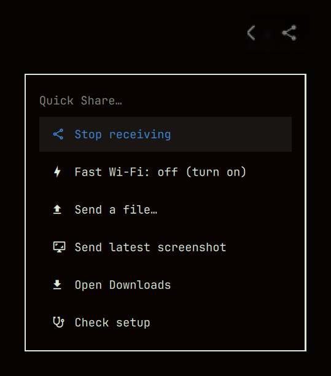

# Quick Share for Omarchy

Send files between your Omarchy PC and an Android or Samsung Galaxy phone with the phone's own **Share → Quick Share**. You don't install anything on the phone, and the phone and PC don't need to be on the same Wi-Fi.



- **Receive**: share from the phone, pick this PC, then choose **Accept** in the menu that pops up. The file lands in `~/Downloads`.
- **Send**: click the bar icon and pick a file, send your latest screenshot, or right-click files in Nautilus → **Scripts → Send to phone (Quick Share)**.
- **One icon** on the bar. It shows when receiving is on, and the progress of a file coming in or going out.
- **Your own devices** can skip the Accept step.

The Quick Share protocol comes from [quickshare-direct](https://github.com/papshmeare/quickshare-direct), over Bluetooth plus Wi-Fi Direct. This plugin adds the bar icon, the `quickshare` command, and Accept/Decline prompts that work with Omarchy's notifications.

## Install

```bash
curl -fsSL https://raw.githubusercontent.com/Emanuel4100/omarchy-quickshare/main/install.sh | bash
```

You can run it again at any time. Steps that are already done are skipped, and it ends with a checklist of the whole setup.

<details>
<summary>Or the Omarchy way, step by step</summary>

```bash
omarchy plugin add https://github.com/Emanuel4100/omarchy-quickshare.git --enable
~/.config/omarchy/plugins/emanuel.quickshare/install.sh
```

If you only run the first command, the bar icon says *"isn't set up yet"*. Clicking it runs the installer in a terminal.

</details>

<details>
<summary>What the installer changes</summary>

| Step | What it does | sudo |
|---|---|---|
| quickshare-direct | Downloads the latest release package, checks it against the release's `SHA256SUMS`, and installs it with `pacman -U` | yes |
| Firewall | `ufw allow quickshare-direct` (TCP 46257–46258), if ufw is on | yes |
| Wi-Fi region | Only if none is set: asks for your country (suggested from your timezone), then runs `iw reg set` and saves it in `/etc/conf.d/wireless-regdom` | yes |
| Notifications | Installs the Quick Share icon in `~/.local/share/icons`, and writes one `PATH=` line to `~/.config/quickshare-direct/env` so Accept/Decline opens as an Omarchy menu ([why](#how-it-works)) | |
| Command | Links `quickshare` into `~/.local/bin` | |
| Sending | Installs `python-dbus` and `python-gobject`, for the Bluetooth beacon that wakes up the phone ([why](#sending)) | yes |
| File manager | Adds **Send to phone (Quick Share)** to Nautilus' right-click → Scripts | |
| Receiving | `systemctl --user enable --now quickshare-direct` | |
| Headphones | Installs `quickshare-audio-guard.service` in `~/.config/systemd/user`; it runs alongside the receiver ([why](#bluetooth-headphones)) | |
| Bar | `omarchy plugin enable emanuel.quickshare` | |
| Fast Wi-Fi | Asks once, default **no** ([details](#faster-transfers)) | yes |

</details>

**Needs:** Omarchy and Bluetooth. A Wi-Fi card with Wi-Fi Direct is optional; it's only for [faster transfers](#faster-transfers).

## Use it

**Receive:** on the phone, open **Share → Quick Share**, pick this PC (its host name), then choose **Accept** on the PC. With Omarchy's own notifications, a received photo shows up as a thumbnail.

**Send:** first put the phone on its Quick Share receive screen, visible to *Everyone*. Then click the bar icon, or select files in Nautilus and right-click → **Scripts → Send to phone (Quick Share)**. Accept on the phone; the PIN matches the one in the notification.

| Bar icon | Action |
|---|---|
| Left click | Pick a recent file and send it; while sending, cancel |
| Middle click | Open Downloads |
| Right click | Menu: receiving on/off, fast Wi-Fi on/off, send a file, send the latest screenshot, open Downloads, trusted devices, check setup (and cancel, while sending) |

The icon is an outline while receiving is off. It turns into a down arrow while a file comes in and an up arrow while one goes out, then shows a ✓ for a moment when the transfer is done. Hover it during a transfer for the progress, the speed and the link it runs over (Wi-Fi Direct or Bluetooth). Clicking the "Received from" notification opens the file.

```bash
quickshare send ~/a.pdf ~/b.jpg   # no file: opens a picker
quickshare cancel                 # stop the send in progress
quickshare devices                # which phones the PC can see (Bluetooth and Wi-Fi)
quickshare receive on|off|toggle  # off during a transfer needs --force
quickshare fast on|off
quickshare audio 100|off           # headphones' lower bitrate: from which size, or never
quickshare trust                  # list, or: trust add|remove "Emanuel's Tab S9+"
quickshare menu                   # the right-click menu
quickshare doctor                 # check the setup
quickshare status                 # {"installed":…,"receiving":…,"fast":…,"sending":…}
```

### Trusted devices

Transfers from a trusted device are accepted without the Accept menu; a notification says so. Right-click → **Trusted devices…** offers the last device that sent you something, or use `quickshare trust add NAME` with the name the phone shows for itself. The name is all that's checked, and any phone nearby can call itself the same while it's visible to everyone. The worst it can do is drop a file in your Downloads folder, but keep that in mind.

## Faster transfers

Without fast mode, transfers go over Bluetooth at a few KB/s. That's fine for a photo but slow for a video. `quickshare fast on` moves transfers to Wi-Fi Direct. **This PC's Wi-Fi stays connected during a transfer** on cards that can run a Wi-Fi Direct group next to a connection, as Intel's can. Elsewhere, the Wi-Fi and internet pause for as long as a transfer runs, then reconnect by themselves. `quickshare fast off` undoes it.

<details>
<summary>How fast mode gets around NetworkManager</summary>

quickshare-direct already tries to switch to Wi-Fi Direct. However, NetworkManager shuts down any Wi-Fi Direct group it didn't start itself, about a millisecond after the group comes up (`P2P: WPA supplicant notified a group start but we are not trying to connect!`). So without fast mode, every transfer stays on Bluetooth.

`quickshare fast on` asks for your password. It then installs `system/quickshare-fastlink` to `/usr/local/lib/omarchy-quickshare/`, along with a drop-in for `quickshare-ap@.service`. For each transfer, the helper tries two ways:

1. **Keep the Wi-Fi.** NetworkManager removes the group with a single D-Bus call to wpa_supplicant, and doesn't check whether that call worked. So the helper adds a D-Bus rule that refuses that one call, starts the group through NetworkManager's own wpa_supplicant next to your connection, and deletes the rule again a second later. NetworkManager itself isn't changed. The group goes on 2.4 GHz by default, because Galaxy phones won't join a group on 5745 MHz or on radar channels. When your network is on 2.4 GHz, the group shares its channel.
2. **Pause the Wi-Fi**, if the first way fails. The helper takes the Wi-Fi card away from NetworkManager, hosts the group itself, then hands the card back and reconnects to your network when the transfer ends.

The journal says which way a transfer took: `journalctl -u 'quickshare-ap@*' -g 'Wi-Fi kept|paused'`. To prefer other channels, set `QS_GO_FREQS="2437 5180 …"` in `/etc/default/quickshare-direct`. To always pause the Wi-Fi, set `QS_KEEP_WIFI=0` there.

The helper runs from a root-owned copy that a plugin update doesn't touch. `install.sh` refreshes it, and `quickshare doctor` flags a copy that doesn't match the plugin.

</details>

### Bluetooth headphones

Bluetooth and Wi-Fi share one chip and its antennas on most laptop and desktop cards, and the Wi-Fi Direct link runs on 2.4 GHz, where Bluetooth lives. Headphones playing over a high-bitrate codec such as LDAC (Sony) take so much airtime that a transfer crawls at about 1 MB/s with pauses of several seconds. With the audio off, the same link moves 5–6 MB/s.

So while a transfer of 50 MB or more runs over Wi-Fi Direct, connected headphones switch to AAC (or SBC), and switch back when it ends. You hear a gap of about half a second at each switch, and a notification says why. Players that pause when the headphones' output goes away (Spotify does) are resumed. Transfers over your home network and smaller files leave the headphones alone, and so does a codec you change yourself in the meantime. `quickshare audio 200` changes the size; `quickshare audio off` turns it off.

Why NetworkManager breaks Wi-Fi Direct, everything tried around it, and measurements: [docs/wifi-direct-notes.md](docs/wifi-direct-notes.md). To see where a slow transfer stalls, run `sudo scripts/qs-trace` while it runs (section 5 there).

## Sending

A phone on its Quick Share receive screen only announces itself once it hears a "device nearby is sharing" Bluetooth beacon. Samsung phones don't show up at all without it. quickshare-direct looks for the phone but doesn't send that beacon, so `quickshare send` sends it ([`scripts/qs-beacon`](scripts/qs-beacon)) for as long as it looks. Other Android phones nearby with Quick Share on may briefly show "a device nearby is sharing" too, just as they do when a phone shares.

## Troubleshooting

Start with `quickshare doctor`, or right-click → **Check setup**. Each ✗ comes with the command that fixes it.

- **The phone doesn't list this PC.** Receiving must be on (a filled icon) and Bluetooth must be on. On the phone, set Quick Share's visibility to *Everyone*.
- **Accept never appears, and the transfer times out.** Doctor shows whether prompts are routed. Every notification the receiver sends is logged to `~/.cache/quickshare-direct/notify.log`.
- **Sending says no phone was found.** The phone has to be on its Quick Share receive screen, visible to *Everyone*, with the screen on. Run `quickshare devices` while it is. It lists the phones the PC finds over Bluetooth, and, under *On this Wi-Fi network*, the ones announcing themselves on your network. quickshare-direct sends over Bluetooth only. A phone that shows up on the network but not over Bluetooth is a quickshare-direct limitation; please report it there with that output.
- **Transfers are slow.** That's Bluetooth. See [faster transfers](#faster-transfers).
- **Receiver logs:** `journalctl --user -u quickshare-direct -f`

## Update and uninstall

```bash
omarchy plugin update emanuel.quickshare
~/.config/omarchy/plugins/emanuel.quickshare/install.sh --uninstall
```

Uninstalling turns off fast mode and receiving, removes the prompt routing, the `quickshare` link and the Nautilus script, and then removes the plugin. It asks before it also removes the quickshare-direct package and its firewall rule.

## How it works

quickshare-direct runs as a systemd user service and asks "accept this transfer?" with a notification that has Accept and Decline buttons. Omarchy's notification popups don't draw action buttons, so the question could never be answered. The installer puts [`bin/notify-send`](bin/notify-send) first on the receiver's `PATH`. That shim handles notifications three ways:

- A notification with several actions becomes an Omarchy picker menu. If the menu closes the moment it opens (another menu took its place), the shim asks once more, then falls back to a popup you click to accept.
- A request from a [trusted device](#trusted-devices) is accepted right away.
- A single-action notification (like "Show in folder") stays a normal toast that runs the action when clicked. For one received file, the click opens the file.
- Everything else goes to the real `notify-send`.

Each notification also gets the Quick Share icon, by its icon-theme name `omarchy-quickshare`. quickshare-direct asks for `network-wireless`, which most themes lack, so Omarchy's notifications would show no icon and [Omapager](https://github.com/omacom/omapager) a letter tile.

The bar widget only drives the bundled [`quickshare`](quickshare) script. It reads `quickshare status`, follows the receiver's journal to see transfers as they happen, and watches the state file `quickshare send` keeps in `$XDG_RUNTIME_DIR/quickshare/`, so a send started from Nautilus shows on the bar too.

## Credits and license

The Quick Share protocol work is [quickshare-direct](https://github.com/papshmeare/quickshare-direct) by papshmeare (GPL-3.0). This plugin is MIT ([LICENSE](LICENSE)), except `system/quickshare-fastlink`, which is adapted from quickshare-direct's `quickshare-ap` helper and stays GPL-3.0 ([LICENSE-GPL-3.0](LICENSE-GPL-3.0)).
